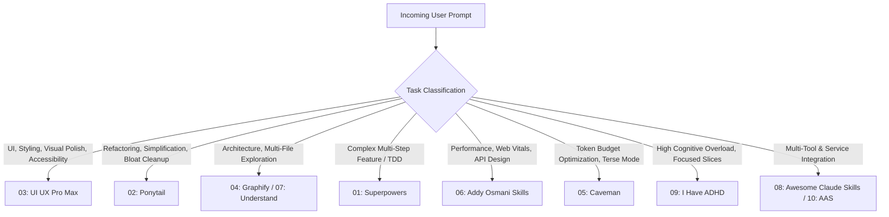

# Antigravity Skills Router & Low-Context Optimization Guide

This project is governed by the **Top 10 Antigravity Skill Repositories**. Whenever a user prompt is received, the assistant automatically routes the task to the most suitable skill below to minimize context window usage and maximize execution precision.

---

## The Top 10 Skill Repositories & Context Efficiency

| Rank | Skill Repository | Primary Focus | Context-Saving Mechanism |
|:---:|:---|:---|:---|
| **01** | **Superpowers** (`obra/superpowers`) | Systematic planning, TDD, branch verification, step-by-step implementation. | Prevents repetitive prompt loops and wasted tokens by establishing strict test verification before claims. |
| **02** | **Ponytail** (`DietrichGebert/ponytail`) | Ultra-lean, minimalist dev ("lazy senior engineer"), YAGNI. | Eliminates bloat and over-engineering; writes the fewest possible lines of code to achieve 100% of the goal. |
| **03** | **UI UX Pro Max** (`nextlevelbuilder/ui-ux-pro-max-skill`) | Design intelligence, typography, micro-interactions, WCAG accessibility, spacing. | Uses on-demand targeted design queries instead of dumping bulky style guidelines into context. |
| **04** | **Graphify** (`Graphify-Labs/graphify`) | Codebase knowledge graphs, dependency maps, architecture exploration. | Replaces broad whole-project file dumping with precise symbol and dependency call paths. |
| **05** | **Caveman** (`JuliusBrussee/caveman`) | High-density, fluff-free communication mode. | Compresses thoughts and outputs by up to 70% while keeping every technical fact intact. |
| **06** | **Addy Osmani Skills** (`addyosmani/agent-skills`) | Web performance optimization, DevTools inspection, clean APIs. | Focuses directly on bottleneck fixes, zero-waste code splitting, and measurable Core Web Vitals. |
| **07** | **Understand Anything** (`Egonex-AI/Understand-Anything`) | Deep mental models, module onboarding, file diff explainers. | Extracts high-level semantic domain models so the model doesn't re-read hundreds of source files. |
| **08** | **Awesome Claude Skills** (`ComposioHQ/awesome-claude-skills`) | External integration skills, multi-tool orchestration, task automation. | Standardizes tool contracts so multi-step workflows complete with minimal intermediate chatter. |
| **09** | **I Have ADHD** (`ayghri/i-have-adhd`) | Laser-focused single-milestone task breakdown, anti-distraction. | Eliminates context drift by maintaining a singular active milestone with binary completion criteria. |
| **10** | **Agentic Awesome Skills** (`sickn33/agentic-awesome-skills`) | Dynamic stack composition, AAS manifest validation. | Composes only the exact sub-skills needed for a task and unloads unnecessary instructions. |

---

## Automatic Routing Protocol

Before executing any request, the assistant evaluates the prompt against this decision matrix:

### Active Skill Declaration
Whenever a task begins, the assistant briefly acknowledges the selected skill:
> **Active Skill:** `[Skill Name]` — *[One-line justification of why it fits and how it minimizes context]*

